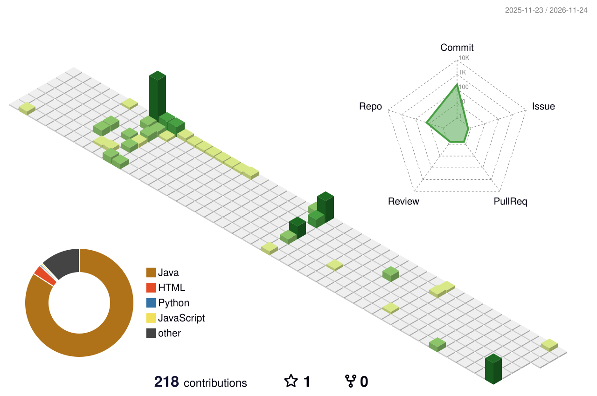

# priyadarshini-tech-maker-s

<!-- =============== PRIYA.EXE | DIGITAL UNIVERSE =============== -->

<div align="center">


<br/>


</div>

---

## 👾 ABOUT ME

```text
> INITIALIZING PRIYA.EXE...
> SYSTEM: ONLINE
> IDENTITY: COMPUTER SCIENCE & CYBERSECURITY STUDENT
> MISSION: LEARN | BUILD | EXPLORE | SECURE
```

- 🎓 Computer Science and Engineering student specializing in Cybersecurity.
- 💻 Exploring software development and cybersecurity.
- 🔐 Learning Linux, networking, web security and ethical hacking.
- 🐍 Practicing Python, Java and problem solving.
- 🚀 Building projects and continuously improving my technical skills.
- 🌌 Dreaming big and turning ideas into real-world technology.

---

## ⚡ MY TECH ARSENAL

<div align="center">


</div>

---

## 🚀 FEATURED PROJECTS

<div align="center">

| PROJECT | DESCRIPTION |
|:---|:---|
| 🔐 Secure Craft Works | Cybersecurity-focused project |
| 🛡️ AdPulseSentinel | Security-oriented project |
| 🤖 SentinelX AI | AI-based internship project |
| 🚗 Vehicle Management | CRUD-based application |
| 🏭 FactoryPilot X | Agentic AIoT digital twin concept |

</div>

---

## 🌐 CONNECT WITH ME

<div align="center">

<a href="https://github.com/priyadarshini-tech-maker">

</a>

<a href="https://www.linkedin.com/in/priyadarshini-p">

</a>

</div>

---

<div align="center">

### 💜 EXPLORE. INNOVATE. SECURE.

<!-- =============== GITHUB STATISTICS =============== -->

<h2 align="center">⚡ MY GITHUB UNIVERSE ⚡</h2>

<div align="center">


<br/><br/>


<br/><br/>


</div>

<!-- =============== END GITHUB STATISTICS =============== -->


</div>

<!-- =============== END PRIYA.EXE =============== -->

<!-- =============== 3D CONTRIBUTION UNIVERSE =============== -->

<h2 align="center">🌌 MY 3D CONTRIBUTION UNIVERSE</h2>

<div align="center">

<p>Every contribution builds my digital universe.</p>

<picture>
  <source
    media="(prefers-color-scheme: dark)"
    srcset="./profile-3d-contrib/profile-green-animate.svg"
  />
  <source
    media="(prefers-color-scheme: light)"
    srcset="./profile-3d-contrib/profile-south-season-animate.svg"
  />
  
</picture>

</div>

<!-- =============== END 3D CONTRIBUTIONS =============== -->

<!-- =============== CONTRIBUTION SNAKE =============== -->

<h2 align="center">🐍 CONTRIBUTION SNAKE</h2>

<div align="center">

<p>Watch my contributions come alive!</p>

<picture>
  <source
    media="(prefers-color-scheme: dark)"
    srcset="https://raw.githubusercontent.com/priyadarshini-tech-maker/priyadarshini-tech-maker/output/github-contribution-grid-snake-dark.svg"
  />
  <source
    media="(prefers-color-scheme: light)"
    srcset="https://raw.githubusercontent.com/priyadarshini-tech-maker/priyadarshini-tech-maker/output/github-contribution-grid-snake.svg"
  />
  
</picture>

</div>

<!-- =============== END CONTRIBUTION SNAKE =============== -->

<!-- =============== PROJECT SHOWCASE =============== -->

<h2 align="center">🚀 MY DIGITAL CREATIONS</h2>

<p align="center">
  <i>Ideas transformed into code. Innovation transformed into reality.</i>
</p>

<div align="center">

<a href="https://github.com/priyadarshini-tech-maker/secure-craft-works">

</a>

<a href="https://github.com/priyadarshini-tech-maker/AdPulseSentinel">

</a>

<a href="https://github.com/priyadarshini-tech-maker/Internship_Project-SentinelX-AI">

</a>

<a href="https://github.com/priyadarshini-tech-maker/Crud_Project1-Vehicle-Management-System">

</a>

</div>

<p align="center">
<a href="https://github.com/priyadarshini-tech-maker?tab=repositories">

</a>
</p>

<!-- =============== END PROJECT SHOWCASE =============== -->

<!-- =============== PRIYA.EXE TERMINAL =============== -->

<h2 align="center">⌨️ SYSTEM TERMINAL</h2>

<div align="center">


</div>

```text
╔══════════════════════════════════════════════╗
║             PRIYA.EXE TERMINAL               ║
╠══════════════════════════════════════════════╣
║  [SYSTEM]       ONLINE                       ║
║  [IDENTITY]     DEVELOPER IN PROGRESS        ║
║  [FOCUS]        SOFTWARE + CYBERSECURITY     ║
║  [MODE]         LEARN | BUILD | SECURE       ║
║  [NEXT LEVEL]   UNLOCKING...                 ║
╚══════════════════════════════════════════════╝
```

<!-- =============== END PRIYA.EXE TERMINAL =============== -->

<!-- =============== TECH ARSENAL =============== -->

<h2 align="center">⚡ MY TECH ARSENAL</h2>

<p align="center">
  <i>Building skills. Exploring technology. Leveling up every day.</i>
</p>

<h3 align="center">💻 PROGRAMMING LANGUAGES</h3>

<div align="center">


</div>

<h3 align="center">🎨 WEB DEVELOPMENT</h3>

<div align="center">


</div>

<h3 align="center">🗄️ DATABASE & TOOLS</h3>

<div align="center">


</div>

<h3 align="center">🔐 CYBERSECURITY & SYSTEMS</h3>

<div align="center">


<br/><br/>


</div>

<h3 align="center">🌱 CURRENT LEARNING JOURNEY</h3>

<div align="center">


</div>

<!-- =============== END TECH ARSENAL =============== -->

## 🌈 NEON DIGITAL LAB

<div align="center">

# PRIYADARSHINI P.

> Software Developer | Cybersecurity Enthusiast | Creative Technologist

<p align="center">
  
</p>

### DREAM. DESIGN. DEVELOP. DEFEND.

</div>

## 👩‍💻 About Me

I'm a Computer Science and Engineering student specializing in Cybersecurity, passionate about building useful technology and exploring the world of software development and security.

- 🐍 Learning Python, Java and JavaScript
- 🛡️ Exploring Cybersecurity, Linux, Networking and Web Security
- 🌐 Interested in Full-Stack Development and Creative Web Experiences
- 🤖 Exploring AI, IoT Security and emerging technologies
- 🚀 Building real-world projects and learning in public

## ⚡ Technology Arsenal

**Programming:** Python · Java · JavaScript

**Frontend:** HTML5 · CSS3 · React

**Backend & Database:** Node.js · MySQL

**Cybersecurity:** Linux · Bash · Networking · TryHackMe · Web Security

**Tools:** Git · GitHub

## 📊 GitHub Signals

<p align="center">
  
</p>

## 🚀 Featured Experiments

- **[Secure Craft Works](https://github.com/priyadarshini-tech-maker/secure-craft-works)** — Cybersecurity-focused project
- **[AdPulse Sentinel](https://github.com/priyadarshini-tech-maker/AdPulseSentinel)** — Project exploring intelligent ad monitoring
- **[Priya Cyber Portfolio](https://github.com/priyadarshini-tech-maker/Priya-cyber-portfolio)** — Personal cybersecurity portfolio
- **[Vehicle Management System](https://github.com/priyadarshini-tech-maker/Crud_Project1-Vehicle-Management-System)** — Full-stack application using Node.js, Express and MySQL
- **[Case Study](https://github.com/priyadarshini-tech-maker/Case--Study)** — System and design case study
- **[Case Study Part 2](https://github.com/priyadarshini-tech-maker/case--study-part2)** — Second-stage system design work

## 🌐 Connect With Me

<p align="center">
  <a href="https://github.com/priyadarshini-tech-maker">
    
  </a>
  <a href="https://www.linkedin.com/in/priyadarshini-p">
    
  </a>
</p>

## 🌌 3D Contribution Universe

<p align="center">
  <picture>
    <source media="(prefers-color-scheme: dark)" srcset="./profile-3d-contrib/profile-green-animate.svg" />
    <source media="(prefers-color-scheme: light)" srcset="./profile-3d-contrib/profile-south-season-animate.svg" />
    
  </picture>
</p>

## 🐍 Contribution Snake

<p align="center">
  <picture>
    <source media="(prefers-color-scheme: dark)" srcset="https://raw.githubusercontent.com/priyadarshini-tech-maker/priyadarshini-tech-maker/output/github-contribution-grid-snake-dark.svg" />
    <source media="(prefers-color-scheme: light)" srcset="https://raw.githubusercontent.com/priyadarshini-tech-maker/priyadarshini-tech-maker/output/github-contribution-grid-snake.svg" />
    
  </picture>
</p>

---

<div align="center">

### ✨ DREAM. DESIGN. DEVELOP. DEFEND. ✨

<sub>Building my digital universe, one project at a time.</sub>

</div>
